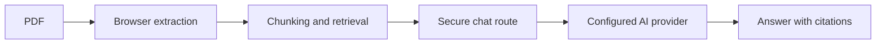

<div align="center">

# Chat with your PDF

### Ask questions. Get grounded answers. See the source.

<p>
  A focused document chat app built with Next.js and an OpenAI-compatible AI provider.
  Upload a PDF, ask questions in plain English, and receive answers with page-level citations.
</p>

<p>
  
  
  
  
</p>

<p>
  <a href="#quick-start">Quick start</a>
  &nbsp;·&nbsp;
  <a href="#features">Features</a>
  &nbsp;·&nbsp;
  <a href="#how-it-works">How it works</a>
  &nbsp;·&nbsp;
  <a href="#deployment">Deploy</a>
</p>

</div>

---

## Overview

Chat with your PDF is designed for answers you can verify. Text is extracted in the browser, the most relevant passages are retrieved locally, and the configured AI provider receives only the selected document context.

<table>
  <tr>
    <td width="33%" valign="top">
      <strong>Grounded by design</strong><br>
      Answers are limited to the uploaded document. If the information is not present, the assistant says so.
    </td>
    <td width="33%" valign="top">
      <strong>Easy to verify</strong><br>
      Every answer can include the page number and source excerpt that supports it.
    </td>
    <td width="33%" valign="top">
      <strong>Private by default</strong><br>
      PDF text is processed in the browser and the Gemini API key stays on the server.
    </td>
  </tr>
</table>

## Features

- **PDF chat** — Upload a document or try the included sample PDF.
- **Page-level citations** — Inspect the source page and supporting text for each answer.
- **Local retrieval** — Sliding-window chunking and TF-IDF scoring select relevant context.
- **Follow-up questions** — Maintain context across a conversation about the current document.
- **Responsive interface** — A clean experience across desktop, tablet, and mobile.
- **Session persistence** — Keep the active conversation in browser `localStorage`.
- **Secure API route** — The provider key is accessed only from the server-side chat handler.

## Quick start

### Requirements

- [Node.js](https://nodejs.org/) 18 or newer
- An API key for an OpenAI-compatible provider, such as [Groq](https://console.groq.com/keys)

### 1. Install dependencies

```bash
git clone <your-repository-url>
cd chat-with-pdf
npm install
```

### 2. Configure your API key

Create `.env.local` from the included template.

<details>
<summary><strong>Windows PowerShell</strong></summary>

```powershell
Copy-Item .env.example .env.local
```

</details>

<details>
<summary><strong>macOS / Linux</strong></summary>

```bash
cp .env.example .env.local
```

</details>

Add your key to `.env.local`:

```env
AI_PROVIDER=groq
AI_API_KEY=your_provider_api_key_here
AI_BASE_URL=https://api.groq.com/openai/v1
AI_MODEL=openai/gpt-oss-20b
```

> Keep `.env.local` private. It is ignored by Git and should never be committed.

### 3. Start the development server

```bash
npm run dev
```

Open **[http://localhost:3000](http://localhost:3000)** and select the included sample document or upload your own PDF.

## How it works



1. **Extract** — `pdfjs-dist` reads the PDF in the browser and preserves page numbers.
2. **Retrieve** — The document is split into overlapping chunks and ranked against the question with local TF-IDF scoring.
3. **Answer** — The selected excerpts and conversation context are sent to `app/api/chat/route.js`, which securely calls the configured provider.
4. **Cite** — The configured AI provider returns a structured answer with supporting page numbers and source snippets.

## Project structure

```text
app/
├── api/chat/route.js     # Server-side AI endpoint
├── chat/page.js          # Chat workspace
├── layout.js             # App shell and metadata
└── page.js               # Landing page and uploader

components/               # Upload, chat, navigation, and citation UI
lib/
├── gemini.js             # AI provider client and grounding prompt
├── pdf.js                # PDF validation and text extraction
├── retrieval.js          # Chunking and relevance scoring
├── useStorage.js         # localStorage hook
└── utils.js              # Shared helpers
public/
└── sample-document.pdf   # Built-in sample document
scripts/                  # Test and utility scripts
```

## Commands

| Command | Purpose |
| :--- | :--- |
| `npm run dev` | Start the development server |
| `npm run build` | Create a production build |
| `npm start` | Start the production server |
| `npm run lint` | Run ESLint |
| `npm test` | Run the automated tests |

Before opening a pull request:

```bash
npm test
npm run lint
npm run build
```

## Deployment

### Vercel

1. Push the project to GitHub.
2. Import the repository into [Vercel](https://vercel.com/).
3. Add `AI_API_KEY`, `AI_BASE_URL`, and `AI_MODEL` in **Project Settings → Environment Variables**.
4. Deploy.

No database or PDF upload storage is required.

## Security

- The AI provider API key is used only in the server-side route handler.
- PDF extraction happens in the browser rather than uploading the original file.
- Server requests are validated before they reach the configured AI provider.
- Document excerpts are isolated in prompt delimiters to reduce prompt-injection risk.

## Roadmap

- [ ] OCR for scanned PDFs
- [ ] Export conversations to PDF or Markdown
- [ ] Compare multiple documents
- [ ] Manual light and dark themes

<div align="center">

---

Built with Next.js, React, Tailwind CSS, and an OpenAI-compatible AI provider.

</div>
